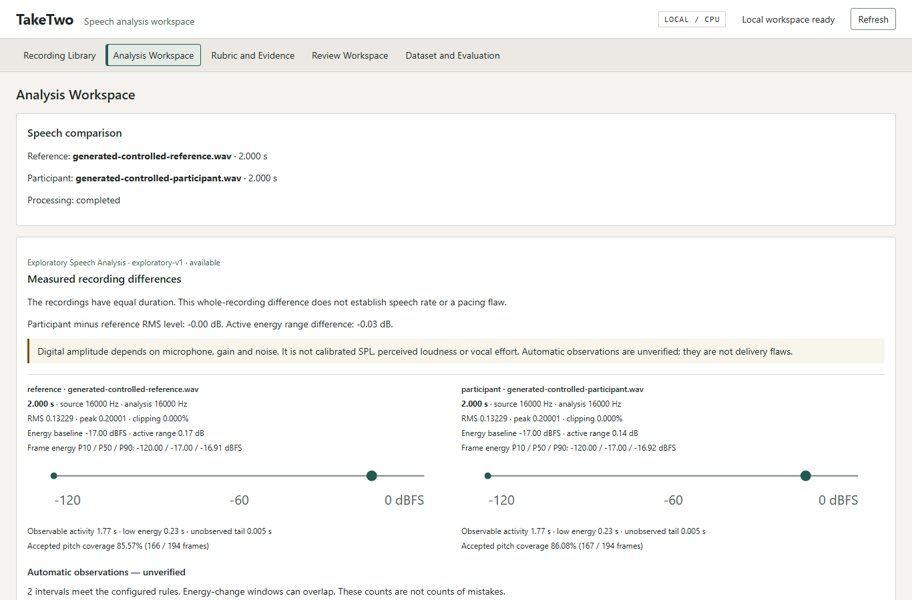

# TakeTwo

**Compare speech. Understand the difference.**

Speech analysis workspace

TakeTwo is a local Windows workstation for comparing reference and participant recordings of the same words. It connects measured acoustic differences to native audio intervals so a listener can inspect what changed and decide whether it matters. Automatic observations remain separate from reviewed delivery assessments.

For judges: [start locally](#three-minute-quick-start), read the [current technical report](output/pdf/taketwo-technical-report-2026-10-15.pdf), and check [submission readiness](docs/publication-readiness.md). Application code is public on `master` at [`9938bd8`](https://github.com/Rhythm-Sanghi/TakeTwo/commit/9938bd89321de3d265931e5a4dd1a232bf7349a6). Its full [Windows CI run](https://github.com/Rhythm-Sanghi/TakeTwo/actions/runs/38615636707) passed. This verifies that application commit; new publication-document commits need their own CI. No public paired dataset or demonstration video is available yet.



Actual application screenshot using generated software signals. It demonstrates the interface and processing pipeline, not human speech accuracy. Private recordings and their screenshots are excluded from this repository.

## Main capabilities

- Import WAV/FLAC recordings and supplied transcripts; retain originals and provenance.
- Inspect duration, digital RMS/peak/clipping, energy, activity and supported pitch.
- Compare native timelines, grouped acoustic observations and provisional word gaps; inspect alignment anomalies and replay reference/participant intervals with A/B controls.
- Export concise Analysis Summaries, searchable Full Evidence Reports and JSON/CSV.
- Collect independent transcript, timing and flaw reviews in Human Review Workspace.
- Inspect dataset prerequisites, review agreement, evaluation availability and exclusions.

## Three-minute quick start

This is the short startup path **after prerequisites are installed**. Downloads and first-time installation can take longer than three minutes. MFA is separate. In PowerShell:

```powershell
git clone https://github.com/Rhythm-Sanghi/TakeTwo.git
cd TakeTwo
.\scripts\start-local.ps1 -Setup
```

Open [the local workspace](http://127.0.0.1:8765). Stop with **Ctrl+C** in the terminal. Next time, run `.\scripts\start-local.ps1` without `-Setup`. Use `-Port 8876` if the default port is occupied. No recordings are seeded.

Without MFA, import, native playback and acoustic analysis work; word alignment and assessments explicitly abstain. The repository has no ready-to-run human corpus. Generated signals are test fixtures only.

## Full setup requirements

Use Windows 11, Python **3.11**, **uv**, and Node.js **24** with npm. CPU processing needs no CUDA, cloud account or paid inference API. See [Windows setup](docs/windows-setup.md) for prerequisite installation, missing-dependency recovery and manual commands. Normal startup reuses the locked Python environment and built frontend.

For forced alignment, install the separate locked **MFA 3.3.9 / CPU Kaldi** environment and checksummed English US ARPA **v3.0.0** model/dictionary using [the exact alignment setup](docs/analysis-engine.md#native-windows-mfa-setup). Then check and launch:

```powershell
uv run taketwo-analysis check --config .\local-data\alignment-config.json
.\scripts\start-local.ps1 -AlignmentConfig .\local-data\alignment-config.json
```

Model installation needs network access; analysis does not download models. The default private workspace is `%LOCALAPPDATA%\TakeTwo\workspace`. Choose `-Workspace .\local-data\judge-session` for a separate workspace. Imports and processing use loopback HTTP and managed local files; keep workspace data, operator keys, consents and exports out of public uploads. The Python wheel supplies the API/CLI, not a prebuilt frontend: launch from a built checkout.

## Reproduce a genuine analysis

1. Supply your own permitted short reference WAV/FLAC and its actual spoken text in **Recording Library**. Confirm local processing permission and record known rights.
2. Add a separate participant take with the intended same-text relationship. Supplied words remain unverified until independent review.
3. In **Analysis Workspace**, run analysis. Inspect measured energy and timing, alignment diagnostics and native A/B playback. An automatic gap is not necessarily silence.
4. Export **Analysis Summary / save PDF**, **Full Evidence Report / save PDF**, or scientific JSON/CSV. Retain input, config and artifact hashes for replay.
5. Use [independent review instructions](docs/reviewed-evidence-workflow.md) before requesting verified assessments or evaluation. No software test grants approval.

Analysis supports at most **45 seconds per member** by default; imports support 100 MiB / 600 seconds. Longer takes remain playable and can be explicitly excerpted with exact excerpt text and original offsets. See the [recording guide](docs/recording-import-guide.md), [user guide](docs/user-guide.md) and [reproduction commands](docs/reproducibility.md).

## Demonstration video

No actual YouTube URL has been supplied or verified. The owner must record and review a **3-10 minute** demonstration, approve audible/visible private material, upload it and verify public playback/duration. [Demo script](docs/demo-script.md).

## Technical report

The [current six-page report](output/pdf/taketwo-technical-report-2026-10-15.pdf) and [editable source](docs/technical-report.md) describe the implemented pipeline and remaining scientific gates. The earlier [report](output/pdf/taketwo-technical-report.pdf) and [source](docs/technical-report-2026-10-12.md) are historical evidence. Rebuild with `scripts/build_submission_report.py` in a separate ReportLab authoring environment; report tools are not application dependencies.

## Dataset access and rights

**The required public paired dataset is missing.** Five genuine private same-speaker practice takes and archival candidates were processed locally; they are not bundled or independently verified ground truth. There is no approved corpus/download URL. Two archival masters share one speaker; acquisition is not paired-dataset completion.

Release requires item-specific redistribution permission, exact reviewed transcripts, independent temporal/flaw labels, provenance and checksums. See the [publication guide](docs/dataset-publication.md) and [remaining owner actions](docs/ACTION-REQUIRED.md). The MIT code license grants no audio rights.

## Architecture and stack

Python 3.11, FastAPI/Uvicorn/Pydantic, NumPy/SciPy/librosa/soundfile, isolated CPU MFA/Kaldi, SQLite and immutable local artifacts; React, strict TypeScript, Vite and uPlot. FFT/MFCC/RMS/energy/pYIN features feed descriptive comparisons and a separate gated rubric. Serial supervised workers provide timeout, cancellation, crash containment and integrity-checked caches. No trained classifier is shipped.

[Architecture](docs/architecture.md), [API](docs/backend-api.md), [comparison methods](docs/comparative-insights.md), [scoring policy](docs/scoring-policy.md), [design system](docs/design-system.md), [permanent standards](AGENTS.md).

## Testing and reproducibility

Locks pin Python/npm/native environment and model resources. Reports bind input, text, config, implementation, model, review and artifact hashes. The previous local hardening pass executed **376 backend, 81 frontend, 18 generated browser and 3 private genuine-pilot tests**, all passing within their stated scope. [Exact evidence and failures](docs/final-hardening-completion.md). [This release pass](docs/publication-readiness.md) records fresh checks and hosted CI status.

```powershell
uv sync --locked
npm --prefix frontend ci
npm --prefix frontend run build
uv run pytest -q
npm --prefix frontend test -- --maxWorkers=1
npm --prefix frontend run typecheck
uv run python scripts/check_repository.py
uv build --no-sources
uv run python scripts/audit_release.py --packages
```

[Browser testing](docs/browser-testing.md) distinguishes generated software fixtures from opt-in external/private recordings. Private pilot inputs are excluded from CI and Git. Automated results do not establish audible usefulness or scientific accuracy.

## Known scientific limitations

Delivery-v0 is experimental and uncalibrated. Missing rights, verified text, timing, quality or coverage withhold conclusions; unavailable weights are never redistributed. Automatic alignment can fit wrong words. Accepted pitch coverage on the private takes was insufficient; thresholds were retained. Precision/recall/F1, calibrated confidence, cross-speaker generalization and held-out accuracy are unavailable.

Human listening and spoken screen-reader acceptance remain pending. Cold evidence requests can time out under contention. Windows supervision and same-host replay are tested; clean second-machine reproduction is unverified. Acoustic association does not establish persuasion, emotion, speaking ability or a psychological cause.

## AI assistance disclosure

**OpenAI Codex** assisted implementation, integration, testing and documentation under human direction. **ChatGPT** assisted planning, problem interpretation, architecture and technical review. Both belong in Devpost's **Built With** list. Human recordings, consent, independent annotation, listening and final submission remain human tasks. [Attributions](docs/attributions.md), [Devpost draft](docs/submission-draft.md).

## License

Original TakeTwo code and documentation use the [MIT License](LICENSE), copyright (c) 2026 Rhythm Sanghi. Recordings, consent/review records, models and third-party materials retain separate rights. [Dependency notices](docs/dependencies.md).

## Detailed documentation

[Submission compliance](docs/submission-compliance.md), [final hardening evidence](docs/final-hardening-completion.md), [Windows measurements](docs/windows-hardening-evidence.md), [listening acceptance](docs/comparative-listening-acceptance.md), [spoken accessibility](docs/spoken-accessibility-acceptance.md), [report exports](docs/report-export-guide.md), [dataset engineering](docs/dataset-engineering.md). Earlier phase and repair audits remain dated historical records.
